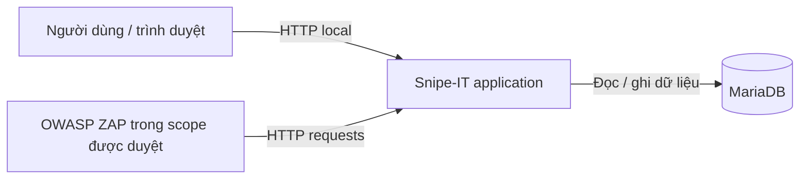

# Kiến trúc và luồng dữ liệu

> Phụ trách: Ngô Văn Chương
> Trạng thái: Sơ đồ logic theo môi trường Docker Compose và phạm vi kiểm thử của nhóm; không phải sơ đồ mã nguồn chi tiết.

Các mã `TC_*` trong tài liệu này thuộc bộ test thủ công/DAST. Bộ Playwright
`AUTH-*`/`AUTHZ-*`/`ASSET-*`/`API-*`/`COOKIE-*` là bộ chức năng tự động riêng,
được mô tả trong [automation report](../automation/docs/TEST_CASE_IMPLEMENTATION_REPORT.md).

## Sơ đồ component/container

Sơ đồ thể hiện các thành phần trong môi trường lab được mô tả ở [`setup-docker.md`](setup-docker.md). ZAP chỉ hướng tới instance local đã xác nhận; cấu hình, phiên bản công cụ và lệnh chạy cần được ghi trong [`dast-runbook.md`](dast-runbook.md).

## Module liên quan

| Module/khía cạnh | Trách nhiệm | Luồng/test liên quan |
|---|---|---|
| Xác thực và session | Tiếp nhận đăng nhập, duy trì session và áp dụng yêu cầu xác thực | `TC_AUTH_001`–`TC_AUTH_003` |
| Phân quyền | Kiểm tra quyền theo role khi đọc hoặc thay đổi tài nguyên | `TC_AUTHZ_001`, `TC_AUTHZ_002` |
| Quản lý tài sản | Hiển thị tài sản và xử lý dữ liệu nhập/sửa | `TC_ASSET_001`, `TC_ASSET_002` |
| API | Tiếp nhận request API và áp dụng kiểm tra xác thực/đầu vào | `TC_API_001`, `TC_API_002` |
| HTTP security | Trả cookie/header; được quan sát thủ công và bằng ZAP | `TC_COOKIE_001`, `TC_ZAP_001`, `TC_ZAP_002` |
| Database | Lưu dữ liệu ứng dụng trong môi trường lab | Docker Compose service MariaDB |

## Luồng dữ liệu nghiệp vụ

1. **Đăng nhập:** trình duyệt gửi thông tin đăng nhập tới ứng dụng; nhóm quan sát kết quả đăng nhập và cookie/session trên response. Không ghi lại thông tin xác thực vào evidence.
2. **Truy cập theo role:** ứng dụng nhận request tới tài nguyên quản trị/tài sản, áp dụng session và quyền đã cấu hình, rồi trả dữ liệu hoặc trạng thái từ chối phù hợp.
3. **Quản lý tài sản:** người dùng có quyền gửi yêu cầu xem/tạo/sửa tài sản; ứng dụng kiểm tra đầu vào và quyền trước khi xử lý dữ liệu với database.
4. **API/DAST:** test client hoặc ZAP gửi request trong scope local; ứng dụng phản hồi, ZAP thu thập cảnh báo để nhóm đối chiếu độc lập. Endpoint API chỉ được thêm sau khi xác nhận trên phiên bản đã khóa.

Các luồng trên là mô hình logic phục vụ thiết kế test; không khẳng định chi tiết triển khai nội bộ chưa được xác minh trong source của commit đã khóa.
